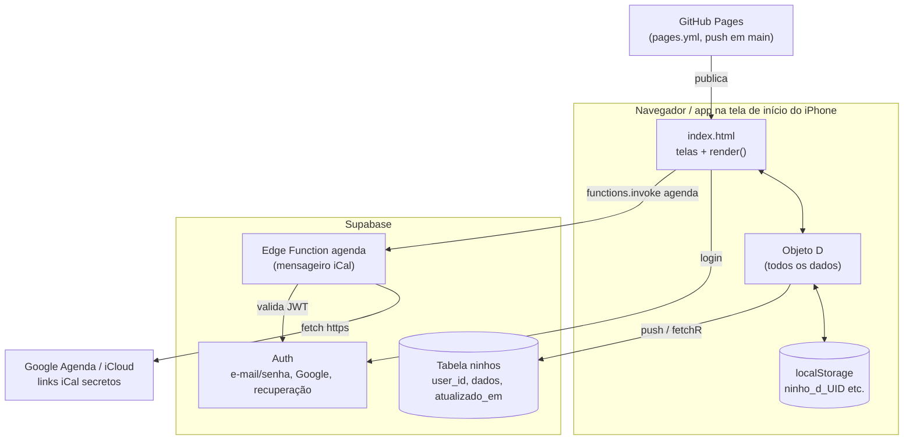
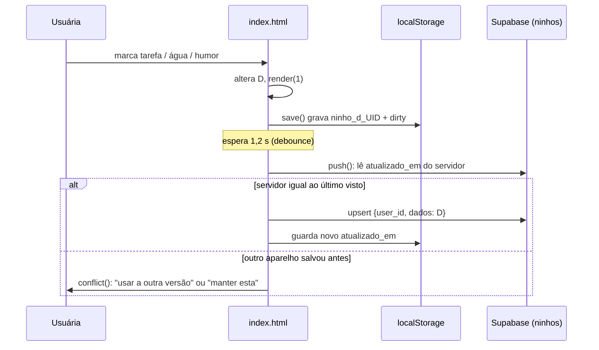
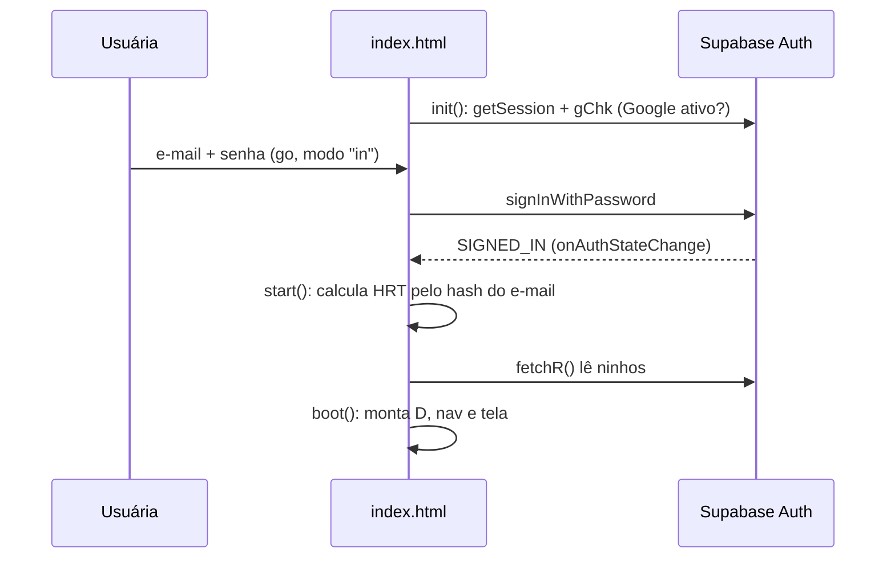

# Mapa do código do Ninho

> Gerado pela skill Cartographer. Último mapeamento: 2026-11-12T00:12:04Z.
> As contagens de tokens são estimadas (caracteres ÷ 4). Os números de linha são aproximados e se referem a `index.html`.

## Visão geral

O Ninho é um organizador pessoal calmo (tarefas, saúde, agenda, diário, estatísticas), pensado para TDAH e menopausa, todo em português. O app inteiro é **um único arquivo estático `index.html`** (HTML + CSS + JS, sem framework e sem etapa de build). Ele usa o Supabase como backend e é publicado pelo GitHub Pages.

**Analogia:** o `index.html` é uma casa de um cômodo só. Todos os móveis (telas, estilos, lógica) ficam no mesmo espaço. O Supabase é o cofre do banco onde fica uma cópia da caixa com tudo (`D`). O `localStorage` é a gaveta de casa, onde fica a cópia do dia a dia.



## Estrutura de pastas

```
Ninho/
├── index.html                  # O app inteiro (~106k tokens, 667 linhas longas)
├── supabase.js                 # @supabase/supabase-js UMD vendorizado (minificado, não editar)
├── supabase/functions/agenda/
│   └── index.ts                # Edge Function Deno: busca e expande calendários iCal
├── emails/                     # Modelos de e-mail do Supabase Auth em pt-BR (colados à mão)
│   ├── README.md
│   ├── confirmar-conta.html
│   ├── convite.html
│   └── recuperar-senha.html
├── .github/workflows/pages.yml # Publica a raiz do repo no GitHub Pages
├── .claude/skills/cartographer # Esta skill de mapeamento
├── docs/CODEBASE_MAP.md        # Este arquivo
├── README.md                   # Hospedagem, dados, login, prévia, agendas
├── PROXIMOS-PASSOS.md          # Checklist vivo (pendências, ideias, relógio Xiaomi)
└── .nojekyll
```

## Guia dos módulos

### `index.html`: o app

**Layout do arquivo**

| Linhas | Conteúdo |
|---|---|
| 1–7 | `<head>`, Google Fonts (Fraunces + Nunito Sans) |
| 8–229 | `<style>` em **camadas de sobrescrita** (o bloco que vem depois vence) |
| 230–232 | Esqueleto: `#bg`, `#app`, `<nav id="nav">`, modal `#md` com `#sh`, `#toast`; `<script src="supabase.js">` |
| 233–666 | Um único `<script>` inline; `init()` no final é o ponto de entrada |

**Blocos de CSS (do mais antigo ao que vence)**

| Linhas | Bloco |
|---|---|
| 8–52 | Tema base (`:root` antigo, `.card`, `.chip`, `.seg`, `nav`, `#md`) |
| 53–84 | Escala de fonte, linhas `.li`, animações das formas de remédio, popup `#pp` |
| 85–116 | Cards translúcidos sobre fundo ilustrado, nav flutuante, pop-ups centrais, texto fixo |
| 117–141 | "Identidade Ninho": **tokens de cor e fontes atuais** (`--mf`, `--ta`), splash `#hi` |
| 142–170 | Ícones da nav, galho e passarinhos, seletor de avatar |
| 171–188 | Tela de login |
| 189–229 | "Revisão geral": escala final de tamanhos, rolagem, `--navH`, cronômetro, agenda |

**Seções de JS**

| Linhas | Conteúdo |
|---|---|
| 234–256 | Helpers (`$`, `iso`, `TODAY`, `esc`, `ls`), estado global, `blank()/rd()/day()`, constantes (`CT PR MS MO SY BS IC`…), `A()` e `hero()` |
| 257–270 | Sons (`snd`, `tone`), vibração (`hap/vibr`), `toast`, `gain` (XP) |
| 271–304 | Cliente Supabase, `PV` (prévia), `save/push/conflict/cfxR`, eventos de agenda (`evGet`), `fetchR`, `sync` |
| 306–355 | Login: `auth`, `ERR`, `go`, `gGo`, `start`, `gChk`, `init` |
| 356–371 | `boot`, `out`, avatar, `hdr`, mapa de abas `V`, `render`, `go2`, modais (`openM/mdBack/closeM`) |
| 372–407 | Tarefas e cronômetro |
| 409–438 | Saúde e Diário |
| 439–464 | Agenda (`calV`, `ics`) e Estatísticas (`statsV`) |
| 465–508 | Perfil, configurações, recompensas, segurança, conexões de agenda |
| 509–536 | Exportação `.xlsx` feita à mão (`CRC`, `zip`, `xlsx`, `csv`) |
| 537–590 | Recorrência e tarefas fixas, reposição hormonal (HRT) e exames, formas de remédio, popup de recompensas, fundos |
| 591–648 | Boards de tarefas (`item2`, `doneV`, `catM`), splash, galho e passarinhos |
| 649–666 | Avatares (**linha 650 tem ~294 KB de SVG: nunca imprimir nem editar à toa**) |

**Abas** (mapa `V`, linha ~364; botões da nav em `boot`, ~358)

| Tecla | Aba | Função da tela | O que faz |
|---|---|---|---|
| `t` | Tarefas | `tasksV` (375) | Lista do dia por período, prioridade, categoria, repetição, "Feito (n)", tarefas que "ficaram para hoje", XP ao concluir, cronômetro (`tmM`, 385–407) |
| `h` | Saúde | `healthV` (412) + `hrtV` (560) | Água, refeições, remédios, exercício; sintomas do corpo, reposição hormonal e exames |
| `c` | Agenda | `calV` (440) | Calendário do mês com pontinhos de hábitos e eventos externos (Google/Apple), só leitura; exporta `.ics` |
| `d` | Meu Diário | `diaryV` (429) | Humor 1–5, sensações, acontecimentos, notas, "Registrar diário" |
| `s` | Estatísticas | `statsV` (454) + `hormV` (576) | Humor contra hábitos, mapa de acontecimentos, correlações automáticas, tendência hormonal, gráficos de exames |

Perfil e configurações abrem como folhas no modal: `prof` → `infoS`, `uiS`, `dataS` (Conexões e dados), `regS` (remédios `medS`, HRT `hrS`, tarefas fixas `fxS`, água `waterS`, recompensas `rwS`).

### `supabase/functions/agenda/index.ts`: o "mensageiro"

- **Para quê:** o navegador não consegue ler links iCal direto (CORS), então esta função busca o link no servidor, expande eventos recorrentes e devolve uma lista simples.
- **Entrada:** `POST {urls:{google?,apple?}, de?, ate?}` com `Authorization: Bearer <JWT do usuário>`.
- **Saída:** `{eventos:[{cal,t,s,e,ad,l}], status:{[cal]:{ok,nome,total} | {ok:0,erro}}}`.
- **Segurança:**
  - Valida o login chamando `/auth/v1/user`, por isso a verificação de JWT do gateway fica **desligada**.
  - Só aceita os hosts `calendar.google.com` e `*.icloud.com`, sempre https (`webcal:` é convertido).
- **Dependência:** `npm:ical.js@2.2.1`. Variáveis de ambiente: `SUPABASE_URL` e `SUPABASE_ANON_KEY` (opcional, com a chave pública como reserva).
- **Publicação:** manual, colando o código no painel do Supabase. Não passa pelo CI.

### `emails/`

São modelos HTML em pt-BR (Confirmar conta, Recuperar senha, Convite), colados à mão em Supabase → Authentication → Emails. O único placeholder é `{{ .ConfirmationURL }}`, e o assunto de cada e-mail é definido no painel. A edição só funciona porque o SMTP próprio (Gmail) está ativo.

### `.github/workflows/pages.yml`

Roda a cada push em `main` (ou manualmente). Envia **a raiz inteira do repositório** para o Pages, sem build. O site fica em `https://gabrielelimacst-ship-it.github.io/Ninho/`.

## Fluxo de dados

### Salvar e sincronizar



- `sync()` roda quando a aba volta a ficar visível e quando a conexão volta. Se o aparelho não tem mudanças pendentes e o servidor está mais novo, ele **substitui sem perguntar**.
- O critério é "a última gravação vence", com aviso de conflito. Não há mescla.
- Chaves do `localStorage`, todas por usuária: `ninho_d_`, `ninho_dirty_`, `ninho_at_` e `ninho_ev_` seguidas do UID. Todas são apagadas ao sair (`out`).

### Login



- Modos de `go()`: `in` entrar, `up` criar conta, `rec` recuperar senha, `np` nova senha (via evento `PASSWORD_RECOVERY`), `link` link mágico (o código existe, mas não há botão).
- **Seção de menopausa só para a dona:** `HRT_H` (~275) guarda o SHA-256 do e-mail da dona, nunca o e-mail. Ao iniciar, `boot` força `D.cfg.hrt` com esse resultado.
- **Modo prévia:** `?previa` ou `window.NINHO_PREVIEW` faz o app abrir sem login e sem rede, com os dados só no navegador. Fica sem menopausa, a menos que `window.NINHO_HRT` esteja definido.

## Modelo de dados (`D`, gravado inteiro em `ninhos.dados`)

- **Raiz** (`boot`, ~356): `tasks[]`, `days{}`, `meds[]`, `ev[]`, `xp`, `id`, `sp` (pontos gastos), `fx[]` (tarefas fixas), `hr[]` (reposição), `lab[]` (exames), `rw[]` (recompensas), `tm` (cronômetro), `evs`, `exm` e `cfg{snd,vib,fx,exm,goal,photo,nick,email,bd,av,cal{google,apple},hrt}`.
- **Tarefa:** `{id,t,p:'b|m|a',c,d,x,dt,pd:'m|t|n',src,rr,tm}`.
- **Dia** (`blank()`, ~238): `{w, ml[3], md{remédio:bool}, ex[], mood, sy[], ev[], nt, hr{}, bs[], bo[], reg}`.
- **Campo novo:** basta colocar o valor padrão em `boot` (raiz ou `cfg`) ou em `blank()` (por dia). Não é preciso mudar nada no Supabase.

## Convenções

- JS compacto, com nomes curtos e tudo global. Os handlers são `onclick="fn()"` inline, então as funções precisam continuar globais.
- Sufixos dos nomes:
  - `…V` devolve o HTML de uma tela.
  - `…S` abre uma subtela de configuração (`scr()`).
  - `…M` abre um modal.
  - `…L` desenha uma lista.
  - Pares de adicionar/apagar: `addX`/`dX`.
- Padrão de mudança: altera `D` → `save()` → efeitos (`snd`, `vibr`, `gain`, `conf`) → `render(1)`.
- Datas são strings `'YYYY-MM-DD'` comparadas como texto. Para converter, use `+'T12:00'` e evite o fuso.
- Tudo o que a usuária lê está em português. A Edge Function evita acentos e crases no código.

## Pegadinhas

- **CSS em camadas:** `.card` é definido nas linhas ~12, 85 e 113. Edite **o último bloco** que mexe na propriedade, senão a mudança não aparece.
- **Linhas gigantes:** a 650 (avatares) e as ~356, 462, 469 e 622 têm muitos comandos cada. Faça edições pontuais por texto exato.
- **Flags com nomes parecidos:** `D.exm` diz se os remédios de exemplo já foram semeados. `D.cfg.exm` liga a seção de exames. `D.evs` diz se os acontecimentos padrão já foram semeados.
- **Rolagem:** com a nav visível, quem rola é o `#app` (fixo), não o `window`. `nvH()` define `--navH`.
- **Código morto:** `authOld`, `hs`, `item`, `GOOGLE_OFF` e tudo depois do `return` em `glSync` (~629), por isso o galho persistente está desligado.
- **Concorrência no `push`:** ler e depois gravar não é atômico, então há uma pequena janela de corrida entre dois aparelhos.
- **Remédios são identificados pelo nome:** renomear não é suportado, e dois remédios com o mesmo nome dividem o mesmo check.
- **Recompensas:** o saldo é tarefas feitas menos `D.sp`. Desmarcar uma tarefa reduz o saldo.
- **iPhone:** links de e-mail abrem no Safari, que tem um armazenamento separado do ícone na tela de início. A vibração precisa do iOS 18+.
- **Publicação:** o Pages publica a raiz inteira, então `emails/`, `supabase/`, `docs/` e `.claude/` também ficam públicos. Por isso nunca coloque segredos no repositório. A chave `sb_publishable_…` é pública por natureza, e a proteção vem do RLS.
- **`PROXIMOS-PASSOS.md` está um pouco desatualizado:** o PR #5 já foi mesclado, mas continua desmarcado.

## Guia de navegação

- **Adicionar uma aba nova:**
  1. Crie `xxxV()` usando `A(hero(...), ...)`.
  2. Registre a aba em `V` (~364).
  3. Coloque a tecla na lista da nav em `boot` (~358) e um ícone em `IC` (~246).
  4. Acrescente a letra na string `'thcds'` de `hdr` (~363).
  5. Coloque o CSS no último bloco de estilos.
- **Adicionar algo na Saúde:** use `healthV` (412). Se for de menopausa ou exames, use `hrtV` (560). Para esconder de quem não é a dona, condicione a `D.cfg.hrt`. Para virar um interruptor, use `swc` em `uiS` (~474).
- **Mudar o que é salvo:** mexa em `boot` (~356) e `blank()` (~238). Depois acrescente o dado no `.xlsx` em `csv()` (523–536).
- **Mudar o login:** a tela fica em `auth` (306), o envio em `go` (329), as mensagens de erro em `ERR` (318), a sessão em `start/init/out` (344–360) e a URL de retorno em `back()` (273).
- **Mudar cores e fontes:** os tokens ficam no `:root` "Identidade Ninho" (117–120). Os tamanhos finais ficam na "Revisão geral" (189–229).
- **Mudar a agenda externa:** no app, use `evGet` (290–298) e `calS/calOk` (498–508). No servidor, edite `supabase/functions/agenda/index.ts` e cole de novo no painel do Supabase.
- **Mudar os e-mails:** edite `emails/*.html` e cole no painel do Supabase.
- **Publicar:** faça merge em `main`. O workflow publica sozinho.
